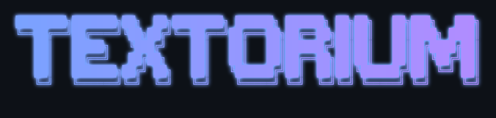
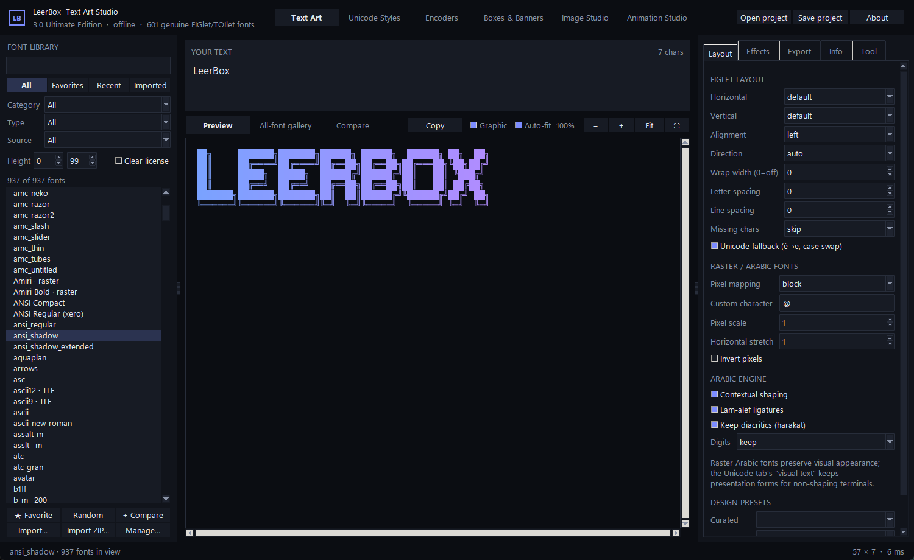
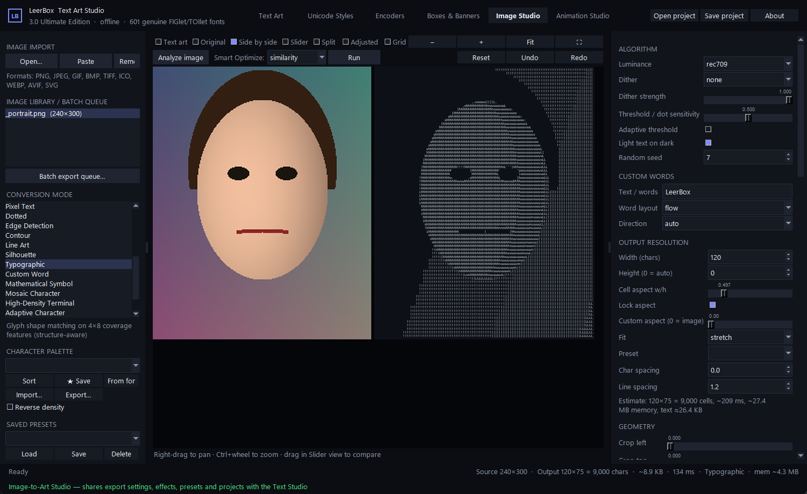
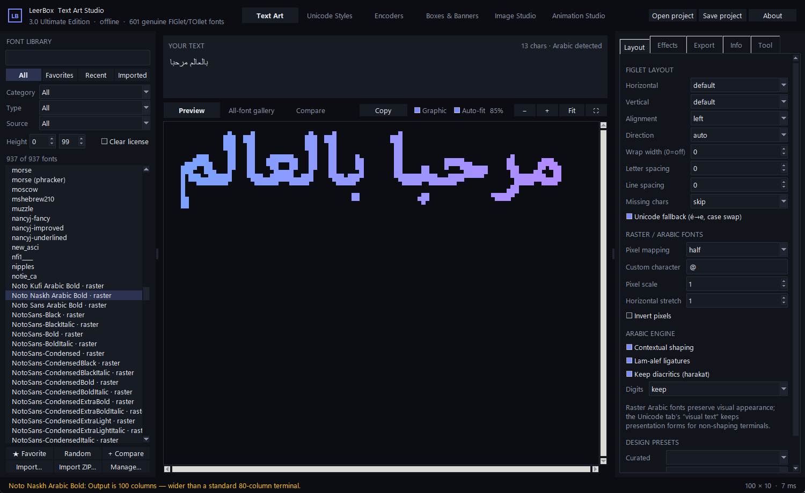
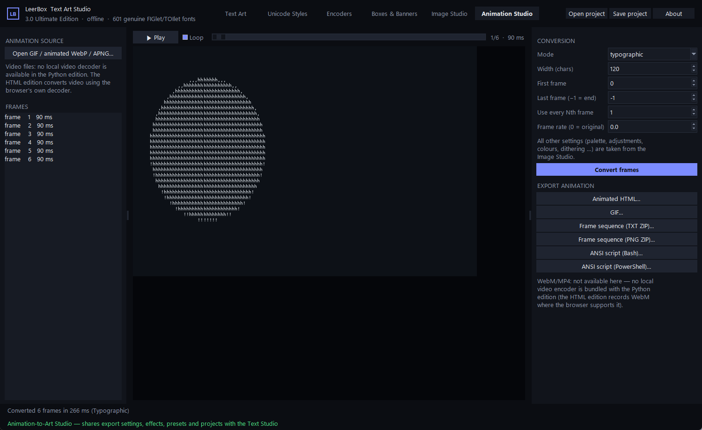

<p align="center"></p>

<p align="center">
  <a href="https://leerbox.github.io/Textorium/"><b>Open in your browser</b></a> ·
  <a href="https://github.com/LeerBox/Textorium/releases/latest"><b>Download</b></a> ·
  <a href="#launch">Command line</a>
</p>

<p align="center">
  <a href="https://github.com/LeerBox/Textorium/actions/workflows/ci.yml"></a>
  <a href="https://github.com/LeerBox/Textorium/releases/latest"></a>
  <a href="LICENSE"></a>
</p>

# Textorium — LeerBox Text Art Studio 3.0

An offline, local-first text-art studio with **601 genuine FIGlet/TOIlet fonts**, a FIGfont-compliant layout
engine, an independent Arabic shaping + bidi engine, a non-destructive effects pipeline, Unicode style
generators, a real export system and three workspaces — **Text-to-Art**, **Image-to-Art** (30 conversion
modes, image analysis, Smart Optimize) and **Animation-to-Art** — in two equivalent editions.
Nothing is ever uploaded: the web page blocks all network requests, and the desktop app has no network code.

| Text Studio | Image Studio |
|---|---|
|  |  |
| **Arabic shaping** | **Animation Studio** |
|  |  |

| Edition | File (from [Releases](https://github.com/LeerBox/Textorium/releases/latest)) | Size | Needs |
|---|---|---|---|
| Web | [use it online](https://leerbox.github.io/Textorium/) or `LeerBox_Text_Art_Studio_V3.html` | 4.1 MB | a modern browser; works offline |
| Desktop (Python/Tk) | `LeerBox_Text_Art_Studio_V3.py` | 4.4 MB | Python 3.10+ with Tkinter; Pillow + NumPy for the Image/Animation Studios |
| Windows executable | `LeerBox_Text_Art_Studio_V3.exe` | 35 MB | nothing (unsigned — see *Known limitations*) |

Every release is built and tested by GitHub Actions from the tagged commit and ships with `SHA256SUMS.txt`
and a build-provenance attestation, so you can check a download really came from this repository:

```powershell
gh attestation verify LeerBox_Text_Art_Studio_V3.exe --repo LeerBox/Textorium
```

Both editions embed the same compressed font pack and share one rendering specification; the
JavaScript engine is a line-by-line port of the Python engine and is verified against the same golden
fixtures (see `TEST_REPORT.md`).

## Launch

```powershell
python LeerBox_Text_Art_Studio_V3.py
```

```powershell
pip install pillow numpy
```
The Text Studio runs on the standard library alone. NumPy is required by the Image and Animation Studios.
Pillow is optional for the Text Studio but recommended: gap-free graphic preview with glow, anti-aliased PNG/JPEG/WebP/BMP
export and JPEG/WebP image input. Without it the app still runs (text preview, PNG/BMP via the built-in
bitmap renderer, PNG/GIF images via Tk).

Open `LeerBox_Text_Art_Studio_V3.html` by double-clicking it. It makes no network requests (enforced by a
Content-Security-Policy), uses a Web Worker for background gallery rendering and falls back to the main
thread where workers are unavailable.

Headless CLI (same script or EXE):

```powershell
python LeerBox_Text_Art_Studio_V3.py --text "Hello" --font slant --effect frame
```

```powershell
python LeerBox_Text_Art_Studio_V3.py --text "Hi" --font big --effect gradient --effect glow --format png -o hi.png
```

```powershell
python LeerBox_Text_Art_Studio_V3.py --list-fonts --search gothic
```

```powershell
python LeerBox_Text_Art_Studio_V3.py --image photo.jpg --image-mode braille --cols 120
```

```powershell
python LeerBox_Text_Art_Studio_V3.py --image logo.png --set mode=sextant --set color=original --format png -o logo.png
```

```powershell
python LeerBox_Text_Art_Studio_V3.py --image photo.jpg --optimize portrait
```

```powershell
python LeerBox_Text_Art_Studio_V3.py --image anim.gif --animate html -o anim.html
```

## Fonts

| Kind | Count | Notes |
|---|---|---|
| Genuine FIGlet fonts (`.flf`) | 570 | from pyfiglet, figlet.js, xero and phracker collections |
| Genuine TOIlet fonts (`.tlf`) | 31 | from the TOIlet distribution and xero |
| **Genuine unique total** | **601** | after removing 1,008 duplicate files (exact and near-duplicate glyph hashes) |
| Arabic raster fonts | 6 | Amiri, Amiri Bold, Noto Naskh/Kufi/Sans Arabic Bold, Vazirmatn Bold (OFL) — rasterized presentation forms + diacritics |
| Raster typography (from V2) | 330 | Noto/Lato/DejaVu/Liberation bitmaps carried over from V2; 13 broken hairline weights removed |
| Algorithmic Unicode styles | 30 | mathematical alphanumerics, enclosed, full-width, small caps, super/subscript, combining styles … |

Genuine fonts are stored unmodified (original headers, authorship and permission statements intact).
Raster designs and algorithmic styles are labelled as such everywhere and never counted as fonts.

**Licensing.** Every font carries `source`, `license` and `licenseTier` in `FONT_MANIFEST.json` and the
Info panel. 103 genuine fonts have explicit terms (FIGlet standard distribution BSD-3, TOIlet WTFPL, or a
license stated in the header); 498 community fonts have no stated license and are redistributed the same
way pyfiglet and figlet.js do. To ship only explicitly licensed fonts (93 after source-level filtering):

```powershell
.\build.ps1 strict
```

## Features

**Rendering engine** — FLF/TLF parsing (hardblanks, endmarks, Deutsch glyphs, decimal/octal/hex/negative
code tags, zipped fonts), horizontal full-width / fitting / controlled smushing (rules 1–6) / universal
smushing, vertical fitting and smushing (rules 1–5), RTL print direction, letter and line spacing, word
wrap by rendered width, left/centre/right alignment, grapheme clusters, wide characters, Unicode fallbacks
(NFC, NFKD base letter, case swap). Output matches the pyfiglet reference on 2,689 cases across 543 fonts.

**Arabic engine** — contextual forms for all joining classes (incl. Persian/Urdu letters), lam-alef
ligatures, transparent diacritics, ZWJ/ZWNJ, tatweel, digit styles (Western/Arabic-Indic/Persian), a UAX #9
bidi implementation (W1–W7, N1–N2, I1–I2, L1–L2, bracket mirroring) for mixed Arabic/English text. Three
output kinds are distinguished: **semantic text** (logical Unicode, for shaping-capable software),
**visual text** (presentation forms in visual order — looks right in non-shaping terminals but loses
semantics) and **raster art** (appearance only). Verified against `python-bidi` and `arabic-reshaper`.

**Effects pipeline** (reorder, enable/disable, configure; JSON-serializable; deterministic PRNG shared by
both editions) — *text-safe*: shadow, double shadow, outline, 3D extrusion, mirror, vertical flip,
rotate 90/180/270, invert, fill character, background character, noise, glitch, zalgo, frames (single,
double, rounded, heavy, ASCII, dashed, stars, block, shade, dots, terminal window), padding; *colour*:
solid colours, horizontal/vertical/diagonal/radial multi-stop gradients, rainbow, matrix; *graphic only*:
glow. The UI states which enabled effects survive plain-text export.

**Raster modes** — one character per pixel (█ # $ ▓ • 1 @ * or custom), half blocks, quarter blocks and
Braille (2×4 dots), with pixel scale, horizontal stretch and inversion.

**Creative tools** — Unicode styles, binary/hex/octal/decimal/code-point/Base64/Morse/Braille encoders
(+ decoders), decorative text boxes, terminal banners, GitHub README banners, CLI application headers,
and image → ASCII / blocks / half-block colour / quarter / Braille with brightness, contrast, gamma,
inversion, threshold, cell aspect, Floyd–Steinberg / Atkinson / Bayer dithering and true-colour mapping.
Images are processed locally.

**Exports** — TXT, ANSI (true colour / 256 / 16), HTML, SVG (optionally embedding DejaVu Sans Mono), PNG,
JPEG, WebP, BMP (transparent backgrounds, padding, scale, font size, line height), Markdown, Python,
JavaScript, C, C++, PowerShell and Bash literals, JSON projects (interchangeable between editions);
clipboard as text, ANSI, rich HTML (CF_HTML on Windows / ClipboardItem in browsers), Markdown and escaped
source; batch export of favourites / compare set / current filter.

## Image-to-Art Studio

**Input** — PNG, JPEG, WebP, BMP, GIF, TIFF, ICO, AVIF (decoder availability is reported in the app and with
`--formats`), SVG through a sanitiser (scripts, event handlers, entities, external references, `<image>`,
`<foreignObject>` and `<style>` are rejected) and a safe rasterizer (desktop: built-in subset renderer —
shapes, paths, solid fills/strokes, transforms; HTML: the browser rasterizes the sanitised SVG). HEIC/HEIF
needs the optional `pillow-heif` package (desktop) or a browser that decodes it (Safari). EXIF orientation is
applied, transparency is kept, animated GIFs are split into frames. Multiple images form a library/batch queue;
clipboard paste (Ctrl+V) in both editions; drag-and-drop in the HTML edition. Decoding limits: 100 MB files,
50 megapixels (decompression-bomb guard), work copies reduced to 2048 px while the original bytes are kept.

**30 conversion modes, each with its own algorithm** — classic ASCII (measured-density ramp), extended ASCII
(2×2 structure matching), shade blocks (error diffusion), half blocks, quadrants and sextants (optimal two-colour
partition per cell), Braille (2×4 dots; threshold/adaptive/dithered, coloured, inverted, transparency-aware),
ANSI 16 (CIELAB palette selection with error diffusion), ANSI 256, true colour, monochrome, grayscale (26 levels,
ordered dithering), binary (local-mean thresholds), matrix (katakana rain), emoji (CIELAB nearest emoji), pixel
text (median-cut palette), dotted (45° halftone screen), edge (Sobel/Canny/DoG + orientation glyphs), contour
(marching squares), line art (DoG + template matching), silhouette (alpha/Otsu segmentation), typographic (4×8
glyph shape matching), custom words (multilingual, RTL/Arabic shaping, wide characters), mathematical symbols,
mosaic (least-squares fg/bg colours on geometric glyphs), high-density terminal (best of all block elements and
sextants), adaptive (ramp vs. shape matching by local detail), hybrid edge + luminance, negative (linear-light
inversion, perceptual mapping) and multi-layer (low-pass colour + detail glyphs + edges).

**Glyph density and matching** — glyph coverage is *measured* (8×16 masks rasterized from DejaVu Sans Mono at
build time; block elements, sextants and Braille computed geometrically). Shape matching uses integer features,
density-window candidate selection (K nearest by coverage) and a cache of quantised cells, so the Python and JS
editions choose the same glyphs.

**Processing** — non-destructive pipeline with undo/redo/reset: crop, rotate (90° steps and free angle), flip,
padding, aspect locking, custom aspect with contain/cover/stretch fit, cell aspect, output width/height presets
(40 … 1000 columns, with a time/memory estimate and confirmation for heavy renders), exposure, brightness,
contrast, gamma, saturation, vibrance, hue, black/white level, shadows, highlights, sharpen, blur, 3×3 median
noise reduction, posterize, grayscale, invert, global histogram equalization, CLAHE, local contrast and
border-connected background removal. Luminance can be Rec. 709, perceptual (CIE L*), linear or average.
Dithering: Floyd–Steinberg, Atkinson, ordered Bayer (8×8) with strength control.

**Colour engine** — monochrome, grayscale, original, ANSI 16, ANSI 256, custom palette, gradient recolouring and
dominant colours (median cut); palette matching uses CIELAB ΔE; colours can go to foreground, background or both.
ANSI output contains only SGR colour codes and resets.

**Palettes** — 18 built-in palettes (basic/extended/high/low-density ASCII, CP437, blocks, Braille, geometric,
mathematical, binary, alphabetic, numeric, dots, lines, symbols, katakana, emoji), custom palettes, reversal,
sorting by measured density, favourites, JSON import/export, and palettes generated from the characters a FIGlet
font uses.

**Image analysis & Smart Optimize** — measured dimensions, luminance distribution, contrast, colourfulness, edge
density, texture, spatial detail, Otsu figure/ground separation, transparency, dominant colours, local luminance
and gradient orientation; rule-based recommendations (each with its reason) for mode, width, palette, contrast,
edge strength, colour strategy and dithering. Smart Optimize renders candidates for 9 presets (detail, similarity,
readability, size, terminal, portrait, landscape, logo, Braille) and scores them by luminance RMSE, SSIM, edge
correlation, CIELAB error, size and terminal compatibility. These are approximations of visual quality — no
machine learning is involved.

**Workspace** — library/modes/palettes/presets on the left; text art, original, side-by-side, comparison slider
and split views with zoom, pan, fit, cell grid and fullscreen in the centre; all settings on the right; a status
line with source size, output size, character count, estimated size, render time, algorithm and memory estimate.

**Exports** — every Text Studio format (TXT, ANSI, HTML, SVG, PNG, JPEG, WebP, BMP, Markdown, Python, JS, C, C++,
PowerShell, Bash) plus image projects (settings + embedded original), comparison PNGs (original next to the
rendered art), batch ZIPs with a per-file report, character and line spacing, and a separate **typographic
composition** (PNG/SVG graphic in which the words vary in opacity, size or weight) that is labelled as a graphic,
not text art.

## Animation-to-Art Studio

GIF / animated WebP / APNG (desktop, Pillow) and GIF (HTML, built-in decoder handling disposal, transparency and
interlacing) and video (HTML only, decoded by the browser) → frame selection, every-Nth-frame skipping (timing is
preserved), frame-rate override, all Image Studio settings, playback preview with loop. Exports: animated HTML
(self-contained player with its own CSP), GIF, frame sequences (TXT/PNG ZIP with timing manifest), ANSI player
scripts for Bash and PowerShell, and WebM/MP4 in browsers that provide a MediaRecorder video encoder. The desktop
edition has no local video encoder or decoder and says so instead of offering those options.

**Font discovery & management** — instant fuzzy search over name/category/tags/author, filters by
category, type, source, height and license tier, favourites, recents, imported, random font and random
design, side-by-side comparison (up to 6), font info (author, license, coverage, layout), import of FLF/TLF
files and ZIP collections with duplicate detection, removal, reset and export of collections (ZIP with
manifest). Imported fonts persist (Python: `%APPDATA%\LeerBox\TextArtStudio3`; HTML: IndexedDB).

**Smart features (deterministic, local)** — unsupported-character detection with compatible-font
suggestions, width warnings (80/120/200 columns), auto-fit preview scaling, curated designs, design
presets, and font recommendations scored as follows:

| Target | Score |
|---|---|
| terminal | 100 − 3·\|h − 6\|, −200 if wider than 80 columns |
| wide | 100 − 2·\|h − 8\|, −200 if wider than 120 columns |
| compact | 100 − 25·max(0, h − 3) − 0.5·w, −200 if wider than 60 columns |
| banner | 60 + 4·min(h, 12), −200 if wider than 160 columns |

Inputs longer than 24 characters get +15 for heights ≤ 5; inputs of 8 characters or fewer get +15 for
heights ≥ 8. Fonts that cannot draw every character are excluded; ties break by name.

**Interface** — dark graphite three-panel workspace (library · editor/preview/gallery/compare · layout,
effects, export, info, tool), virtualized all-font gallery with background rendering and cancellation,
zoom, fit, fullscreen, keyboard shortcuts (Ctrl+S/O/E, Ctrl+±/0, F11, Ctrl+R random), drag-and-drop in
the HTML edition, responsive layout below 1180 px and 760 px.

## Security & privacy

No network code paths exist in either edition (the HTML CSP is `default-src 'none'`; the Python sources
import no network modules — both checked by tests). No eval / `new Function` / `exec` of user or imported
content. Imports are validated: size limits, ZIP entry count/total size/compression-ratio limits,
path-traversal rejection, header and glyph limits, project schema sanitation, HTML/SVG escaping, and C0/C1
control characters (ESC, BEL, CSI…) are stripped from all text before export so imported fonts or pasted
text cannot inject terminal escape sequences.

## Architecture

```
src/leerbox/          modular Python package (the single-file script is generated from it)
  figlet.py           FontParser + FIGlet RenderingEngine        arabic.py      ArabicEngine (shaping, bidi)
  raster.py           bitmap fonts & raster modes                 effects.py     EffectsEngine
  fontdb.py           FontManager (pack, search, imports, ZIP)    textart.py     facade + render cache
  unicode_styles.py   UnicodeEngine                               imageart.py    ImageArtEngine
  export.py           ExportManager                               project.py     ProjectManager + SettingsManager
  smart.py            recommendations, curated/random designs     cli.py         headless CLI
  ui/app.py           ApplicationUI (Tkinter, worker threads)     data/          font pack, Arabic tables, atlas, TTFs
web/src/              HTML edition: engine/*.js (ports), app.js, worker.js, app.css, index.template.html
tools/                build_fonts.py, arabic_raster.py, build_atlas.py, build_python.py, build_html.py,
                      build_exe.py, build_licenses.py, gen_golden.py, benchmark.py, ui_screenshot.py, serve.js
  imgcore.py          image decoding, SVG sanitiser/rasterizer, geometry, filters, adjustments
  imgglyphs.py        palettes, measured glyph masks, shape matching   imgmodes.py   30 conversion modes, colour engine
  imganalysis.py      analysis, recommendations, metrics, Smart Optimize
  imganim.py          animation, typographic composition, image projects, batch
  ui/image_ws.py      Image / Animation Studio workspaces (Tk)
web/src/engine/72-76  JS ports of the Image Studio modules (+ GIF/TIFF codecs); web/src/imagestudio.js UI
tests/                pytest suite + golden fixtures + tests/js/run_tests.js
legacy_v2/            untouched V2.0 originals
third_party/          cloned font repositories and OFL/DejaVu fonts (build inputs, not shipped as-is)
```

UI toolkit decision: Tkinter + ttk with a custom theme. PySide6 would add roughly 100 MB to the EXE and
LGPL obligations; CustomTkinter adds a dependency without capabilities this app needs. Tkinter ships with
Python 3.13 and packages cleanly with PyInstaller.

## Build

```powershell
pip install -r requirements-dev.txt
```

```powershell
.\build.ps1
```

```powershell
.\build.ps1 exe
```

`build.ps1` targets: `all` (fonts, standalone .py, .html, fixtures, tests), `exe`, `html`, `python`,
`fonts`, `test`, `strict`. The FIGlet font sources in `third_party/` are git submodules pinned to the exact
commits the font pack was built from. They are only needed to rebuild the font pack (`fonts`, `strict`), so
clone with submodules for that:

```powershell
git clone --recurse-submodules https://github.com/LeerBox/Textorium.git
```

Continuous integration (`.github/workflows/ci.yml`) runs both test suites on Windows and Linux (Python 3.10
and 3.13) for every push and pull request, and fails if the committed `LeerBox_Text_Art_Studio_V3.py` / `.html`
differ from a fresh build of the sources. Pushing a tag such as `v3.0.1` runs `release.yml`, which builds the
three files, runs the tests, attests the files and publishes the release; `pages.yml` redeploys the web edition
whenever the HTML file changes.

## Known limitations

* The EXE is unsigned. SmartScreen may warn about it, and where Windows **Smart App Control** is on it is
  blocked ("An Application Control policy has blocked this file"). Use the `.py` script or the web edition
  there. Each release EXE has a build-provenance attestation (see above) so its origin can be verified.
* Image Studio: the desktop edition has no drag-and-drop (Tk has no native support; use Open or Ctrl+V), no video
  decoding and no WebM/MP4 encoding. HEIC needs `pillow-heif`. The built-in SVG rasterizer ignores text, filters,
  gradients (drawn grey), masks and clip paths. The browser TIFF decoder handles 8-bit chunky uncompressed, LZW and
  PackBits files only. Emoji, katakana and sextant output depends on the viewer's fonts (warnings are shown).
* GPU acceleration is not used: a WebGPU glyph-matching prototype was benchmarked (see PERFORMANCE_REPORT.md) but
  complete renders are already fast on the CPU, so no GPU code path or GPU dependency was added.
* Vertical smushing is not implemented by figlet 2.2.5 or pyfiglet, so it is verified only for
  cross-edition consistency, not against an external reference.
* Explicit bidi embedding/isolate controls (LRE, RLI, …) are treated as boundary neutrals.
* Arabic raster rendering uses Unicode presentation forms (no OpenType GSUB), so typefaces that rely only on
  GSUB (e.g. Nastaliq) are not included; diacritics are centred over the base glyph rather than anchored.
* The Tk text preview shows small gaps between block-character rows; the default graphic preview
  (Pillow) does not.
* The HTML edition was tested in Chromium (desktop app browser pane, served over http://localhost);
  Brave, Edge and Firefox and the `file://` worker fallback were not tested in this environment.
* C/C++ literal export is implemented but was not compiled in this environment (no C compiler installed);
  the Python, JavaScript, PowerShell and Bash literals were executed and verified byte-for-byte.

See `TEST_REPORT.md` and `PERFORMANCE_REPORT.md` for measured results.
